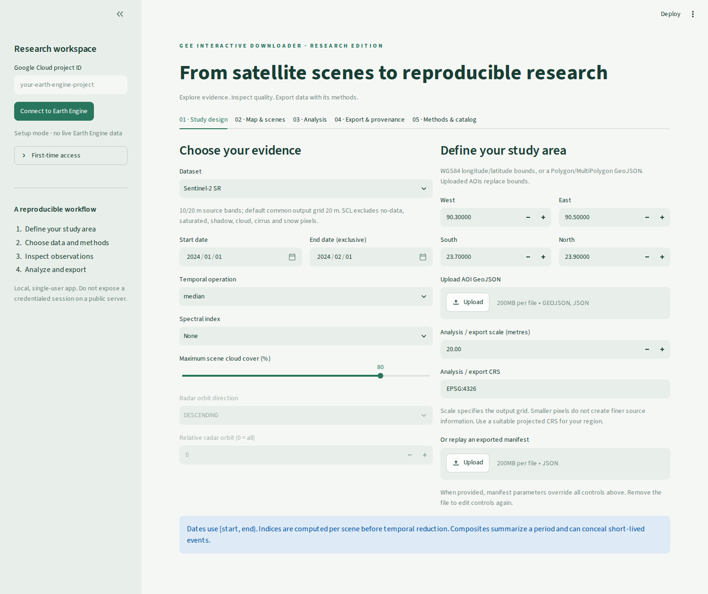
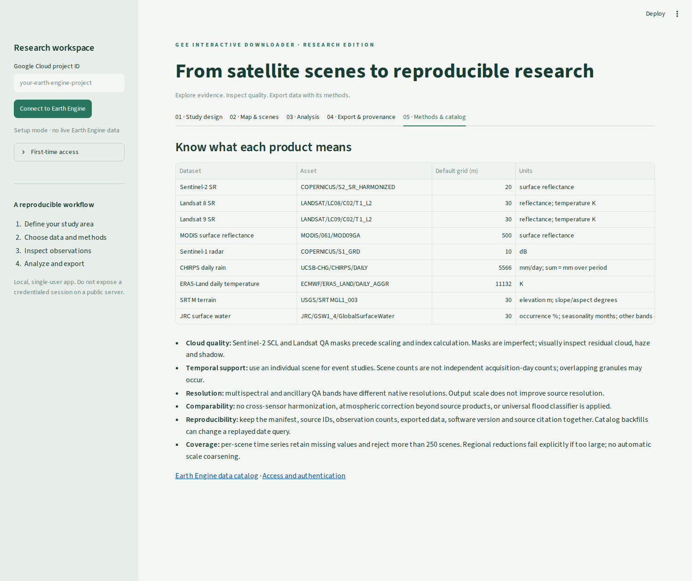

# Earth Engine Research Workbench

Turn a study area and research question into satellite previews, regional statistics, time series and GIS-ready exports—with the processing settings and source scene IDs alongside the data.

This upgrades the original `gee_interactive_downloader` notebook into a **local Streamlit application**. The optional notebook entry point remains available. No hosted service or Google account is included.

## Why use it?

- **Researchers:** retain dates, QA methods, source scene IDs, output grid and observation counts for reporting and reproducibility.
- **GIS users:** export numeric GeoTIFFs for QGIS/ArcGIS, CSV time series and JSON method records.
- **New users:** select a dataset and area without writing Earth Engine code; inspect the map before exporting.

## Access and run

You need Python 3.11+ and a Google account with access to an **Earth Engine registered Google Cloud project**. Follow Google's [access/authentication instructions](https://developers.google.com/earth-engine/guides/auth); eligibility, quotas and billing depend on your account and project. Enable the Earth Engine API and ensure you have permission to use the project.

```bash
git clone https://github.com/Bipul-roy-AI/gee_interactive_downloader.git
cd gee_interactive_downloader
python -m venv .venv
# macOS/Linux:
source .venv/bin/activate
# Windows PowerShell instead: .venv\Scripts\Activate.ps1
python -m pip install -r requirements.txt
earthengine authenticate
python -m streamlit run app.py
```

Open the local URL printed in the terminal (usually `http://localhost:8501`). Enter your **Cloud project ID**, then click **Connect to Earth Engine**. Alternatively set `EE_PROJECT` before launching. You can inspect the interface without credentials; live controls remain disabled until connected.

Run this app locally for one user. Do not expose a credentialed instance publicly: the server's credentials and account tasks would be shared. Never commit credentials, service-account keys or `.streamlit/secrets.toml`.

## Five steps to a result

1. **Study design:** select data, dates (end date is exclusive), temporal operation and optional index. Enter longitude/latitude bounds or upload a WGS84 Polygon/MultiPolygon GeoJSON geometry or Feature. FeatureCollections must be converted first. Set the scale and CRS deliberately.
2. **Map & scenes:** list scenes, inspect acquisition dates, then build the result. For one acquisition, copy its exact `scene_id` into the scene operation. Select a band, adjust display limits and click **Load / refresh image tiles**.
3. **Analysis:** request regional statistics or a per-scene time series. Download the CSV. Compare a baseline period with the current period using the same processing settings.
4. **Export & provenance:** select science and `*_count` bands. Create a small GeoTIFF link or explicitly start a Google Drive export; refresh task status until completed.
5. **Keep your methods:** download the analysis/export manifest alongside your data. Upload it under Study design to replay the configuration. The export manifest also records selected bands and submitted task IDs.

Changing study settings invalidates the previous result so it cannot be exported under new settings.

## Supported workflows

| Research need | Data and functionality |
|---|---|
| Vegetation, agriculture, moisture | Sentinel-2 SR, Landsat 8/9 SR and MODIS reflectance; NDVI, EVI, NDMI |
| Water and built-up surfaces | NDWI, MNDWI and NDBI; JRC historical water occurrence and seasonality |
| Burn/change screening | NBR and current-minus-baseline band/index statistics |
| Radar observations | Sentinel-1 IW VV/VH; orbit-direction and optional relative-orbit filters |
| Rainfall | CHIRPS daily precipitation; sums over a selected period |
| Temperature | ERA5-Land daily mean air temperature; Landsat surface temperature where available |
| Terrain | SRTM elevation, slope and aspect |
| Time and quality | Individual scenes; median/mean/min/max composites; per-band valid-observation counts |
| Export | Small GeoTIFF download; Drive cloud-optimized GeoTIFF task; CSV; JSON provenance |

**Scope:** this is a curated workbench, not every Earth Engine API function. It does not yet implement supervised classification, training-data management, accuracy assessment, zonal tables for many polygons, arbitrary custom assets, automatic flood delineation, trend significance testing or batch scheduling. [Extension guide and roadmap](docs/DEVELOPMENT.md) explain how to add these without overstating their scientific validity.

## Screenshots of the running app

These are browser captures of the actual local application in **unauthenticated setup mode**, not generated mockups or evidence of live Earth Engine retrieval. Live imagery, computed statistics and Drive completion still require validation with your own project.





## Example research tasks

- **Vegetation:** upload `examples/vegetation.json`, connect, build and inspect NDVI. Uncheck natural-color RGB and use −1 to 1 display bounds. Export NDVI together with NDVI_count.
- **Monthly rainfall:** upload `examples/rainfall.json`. Compare `precipitation_count` to the expected number of days before interpreting the precipitation sum. Missing observations are not filled.
- **Event analysis:** list scenes and choose a single acquisition. A monthly median is not a flood-event observation. Radar changes require matching orbit geometry and independent validation.

## Scientific interpretation

Read [Methods and limitations](docs/METHODS.md) before publication. In particular:

- Clouds and shadows are masked before reflectance scaling and per-scene index calculation; masks remain imperfect.
- Output pixel size is **not** a guarantee of native resolution. Sentinel-2 combines 10 m/20 m bands; coarse climate data cannot be made high-resolution by exporting smaller pixels.
- No cross-sensor radiometric harmonization is performed. A median of per-scene indices differs from an index calculated from median reflectance.
- Change is **current minus baseline**. It is not an automatic class label or a significance test.
- Time series retain scene-level observations, including overlapping granules. Means are pixel summaries, not area-weighted regional estimates.
- Catalog data can be revised. Archive the exported data, manifest and software version as well as source IDs.

## Troubleshooting

| Problem | Action |
|---|---|
| Authentication/project failure | Run `earthengine authenticate`; verify project registration, API enablement and permissions. Use the same account locally. |
| No scenes | Check dataset availability, AOI, exclusive end date, cloud threshold and radar orbit filters. |
| All-null statistics | The region/band may have no unmasked pixels; check observation counts and cloud/thermal availability. |
| Download too large | Earth Engine direct downloads have a 32 MB / 10,000-pixel-dimension limit. Use a smaller area/fewer bands or Drive export. The app never silently coarsens data. |
| Reduction exceeds limits | Reduce the time span/area or explicitly choose a coarser scale appropriate to the question. |
| Map empty | Build the result, then load image tiles. Check visualization bounds and network access to Earth Engine and map tiles. |
| Export submitted but no file | Refresh task status; Drive exports are asynchronous and may fail. Inspect the server error/task manager. |

## Notebook users

```bash
python -m pip install -r requirements-notebook.txt
```

```python
import ee
ee.Authenticate()  # first use only
from gee_downloader_safe import main
main(project="your-project-id")
```

Draw a polygon/rectangle and preview a median result. Advanced workflows are in the Streamlit app. The old `SENSOR_DB` and helper names were replaced by `researchgee.catalog` and `researchgee.engine`; importing no longer triggers authentication.

## Validation and development

```bash
python -m pip install -r requirements-dev.txt
python -m pytest -q
# Optional authenticated, read-only check (set EE_PROJECT first):
python scripts/live_smoke.py
```

Offline tests validate inputs, Earth Engine computation graphs, export arguments and interface behavior. They **do not verify live data values or export completion**. See [verification record](docs/VALIDATION.md).

MIT licensed; original author Bipul Roy. Cite each dataset according to its catalog's citation/terms section, and cite the exact repository commit used. The software license does not replace dataset terms.
